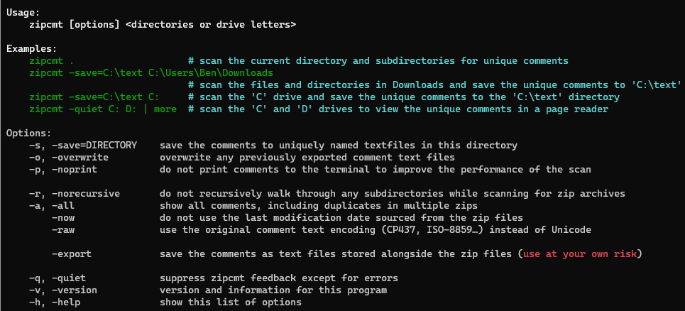

# zipcmt

[](https://pkg.go.dev/github.com/bengarrett/zipcmt)

Zipcmt is the super-fast batch, zip file comment viewer, and extractor.

- Using a modern PC with the zip files stored on a solid-state drive, zipcmt handles many thousands of archives per second.
- Comments convert to Unicode text for easy viewing, editing, or web hosting.<br>
  <small>* comments can also be left as-is in their original CP437 or ISO-8859 text encoding.</small>
- Rarely see duplicate comments to avoid those annoying lists of identical site adverts.
- Transfer the source zip file's last modification date over to any saved comments.
- Tailored to both Windows and POSIX terminal platforms.

## Downloads

Numerous [downloads are available](https://github.com/bengarrett/zipcmt/releases/latest/) for most systems. Zipcmt uses standalone portable binaries and no installation is required.

### Portable Binaries • [Windows](https://github.com/bengarrett/zipcmt/releases/latest/download/zipcmt_windows.zip) • [macOS](https://github.com/bengarrett/zipcmt/releases/latest/download/zipcmt_apple_silicon.gz) • [Linux](https://github.com/bengarrett/zipcmt/releases/latest/download/zipcmt_linux.gz) •

Before use, macOS users will need to delete the 'quarantine' extended attribute that is applied to all
program downloads that are not notarized for a fee by Apple.

```
$ xattr -d com.apple.quarantine zipcmt
```

There is also a [legacy edition that works](https://github.com/bengarrett/zipcmt/releases/download/v1.3.10/zipcmt_Windows_Intel.zip) on Windows 7 and 8.

### Homebrew

macOS and Linux users can install via Homebrew:

```bash
brew tap bengarrett/zipcmt https://github.com/bengarrett/zipcmt
brew install bengarrett/zipcmt/zipcmt
```

Update to the latest version with:

```bash
brew upgrade bengarrett/zipcmt/zipcmt
```

### Linux Packages • [Debian DEB](https://github.com/bengarrett/zipcmt/releases/latest/download/zipcmt.deb) • [Fedora RPM](https://github.com/bengarrett/zipcmt/releases/latest/download/zipcmt.rpm) • [Arch ZST](https://github.com/bengarrett/zipcmt/releases/latest/download/zipcmt.pkg.tar.zst) • [Alpine APK](https://github.com/bengarrett/zipcmt/releases/latest/download/zipcmt.apk) •

## Windows Performance

The out of the box, performance on Windows is poor due to the default Defender Antivirus real-time protection.
For a scan of 10000 zip files **should take one or two seconds**, but with the real-time protection active it **will take minutes**!
To fix this either,

- Temporarily disable **Virus & threat protection, Real-time protection** in Windows Security
- [Create **Windows Security Exclusions**](https://support.microsoft.com/en-us/windows/add-an-exclusion-to-windows-security-811816c0-4dfd-af4a-47e4-c301afe13b26) for the folders to be scanned before running zipcmt

## Usage



## Example usage

#### Scan and print the comments

```sh
$ zipcmt test/

#  ── test/test-with-comment.zip ───────────┐
#    This is an example test comment for zipcmt.
#
# Scanned 4 zip archives and found 1 unique comment
```

#### Only print the comments

```sh
$ zipcmt --quiet test/

#   This is an example test comment for zipcmt.
```

#### Scan and save the comments

Linux, Apple...

```sh
$ zipcmt --noprint --save=~ test/

# Scanned 4 zip archives and found 1 unique comment

$ cat ~/test-with-comment-zipcomment.txt

#   This is an example test comment for zipcmt.
```

Windows PowerShell

```powershell
$ zipcmt.exe --noprint --save='C:\Users\Ben\Documents' .\test\

# Scanned 4 zip archives and found 1 unique comment

$ type 'C:\Users\Ben\Documents\test-with-comment-zipcomment.txt'

#   This is an example test comment for zipcmt.
```

## Usages online

Reddit user [Iron_Slug](https://www.reddit.com/user/Iron_Slug/) in [r/bbs](https://www.reddit.com/r/bbs/) created a [huge online collection of BBS ads](https://www.ipingthereforeiam.com/bbs/gallery/zip/), many of which were captured using zipcmt.

The website Defacto2 has [a large collection of uncurated BBS ads](https://defacto2.net/f/b428b6e) also captured using zipcmt.
